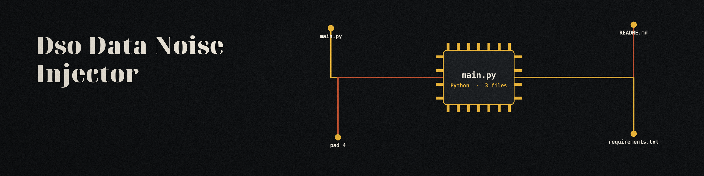

# dso-data-noise-injector
Inserts random, statistically insignificant noise into numerical data fields to prevent reverse engineering of precise values while preserving general trends. - Focused on Tools for sanitizing and obfuscating sensitive data within text files and structured data formats

## Install
`git clone https://github.com/ShadowGuardAI/dso-data-noise-injector`

## Usage
`./dso-data-noise-injector [params]`

## Parameters
- `-h`: Show help message and exit
- `--noise_level`: No description provided
- `--file_type`: No description provided
- `--encoding`: Specify the encoding of the input file. If not provided, it will be automatically detected.

## Behavior notes
- The output file must differ from the input file. If the resolved output path is the input file, under any spelling (the same path, a `./` alias, or a symlink), the run refuses and exits 1 before writing anything.
- `--noise_level` must be greater than 0 and at most 1. A noise level of 0 is rejected at validation and exits 1.
- Every run counts the values it noises and logs that count. A run that noises zero values (for example a CSV with only text cells, or a header only CSV) prints a plain "No values noised" line, writes no output, and exits non-zero.
- Zero values receive noise too. A zero is noised using the range of its column (CSV) or of the whole file (JSON) as the scale, instead of the value itself, which would leave it at zero. When that range is also zero, the fallback scale is 1.0, so a zero still moves by up to the noise level.

## License
Copyright (c) ShadowGuardAI
